# ひとくち — コンビニ新商品の口コミサイト

[](https://github.com/Beachovin/hitokuchi/actions/workflows/ci.yml)

**https://hitokuchi.ak-lumina-inc.workers.dev**

セブン-イレブン・ファミリーマート・ローソン・ミニストップ・デイリーヤマザキの新商品を毎朝自動で集めて一覧にし、実際に食べた人が口コミを投稿・閲覧できる Web サイトです。

「新商品が気になるけど、当たりかな？」を、食べた人の声で確かめられる場所を目指しています。新商品の情報は自動で集めるので、利用者は口コミを読む・書くことに集中できます。

---

## スクリーンショット

### お客様向けの画面（スマホ）

スマホで使うことを前提に、アプリのような見た目と操作感にしています。

| トップ | 商品詳細 | 口コミ | 新商品バトル | はじめての方へ |
|:---:|:---:|:---:|:---:|:---:|
| 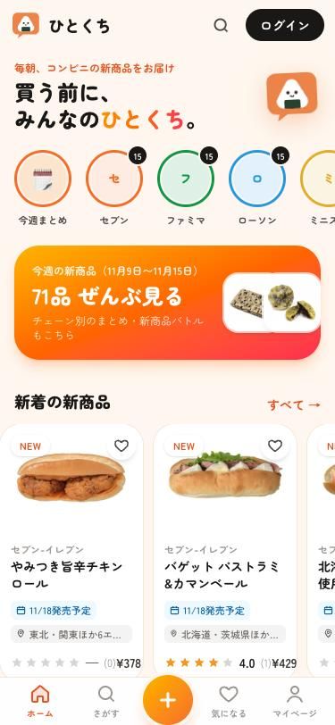 | 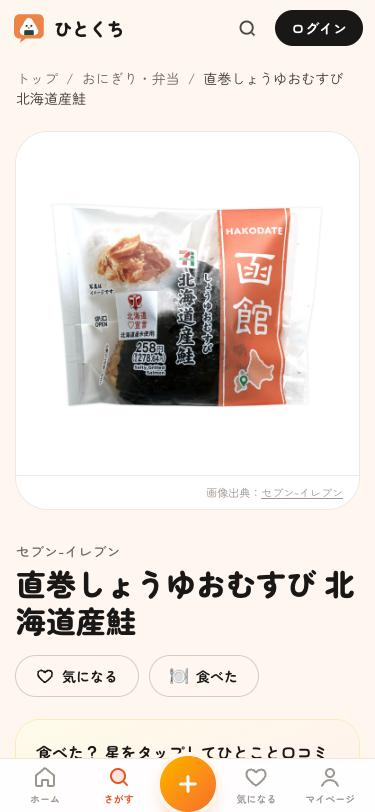 | 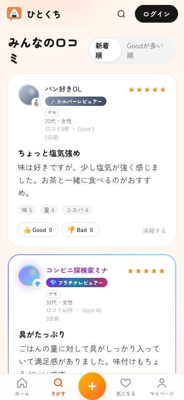 | 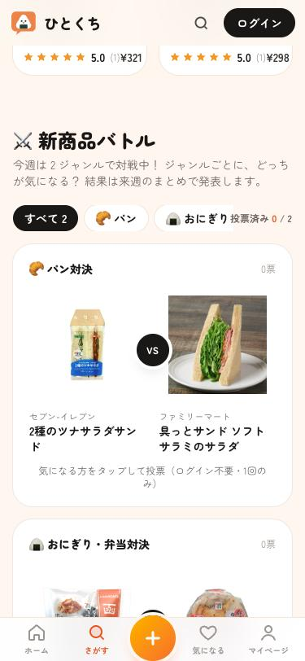 | 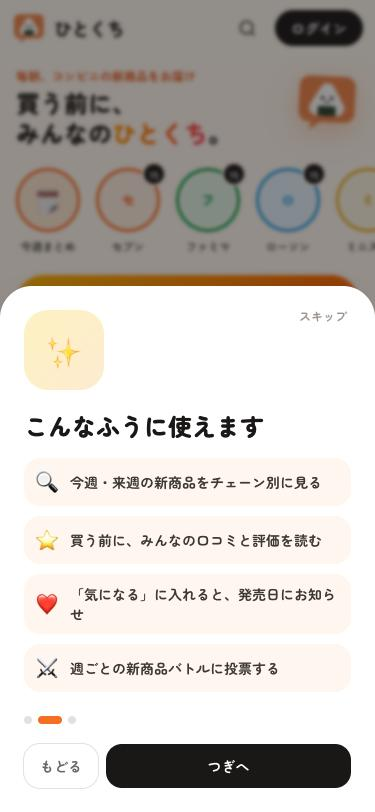 |
| 今週の新商品をチェーン別に表示 | 商品情報・評価・「気になる」 | ランクで装飾が変わる口コミ | ジャンルごとの週替わり対決 | 初回だけ出る使い方の案内 |

### お客様向けの画面（PC）

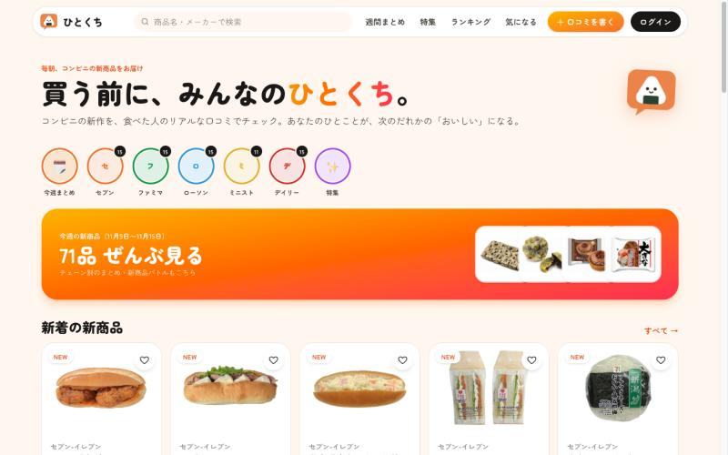

### 管理画面

| ダッシュボード | 収集元・ログ |
|:---:|:---:|
| 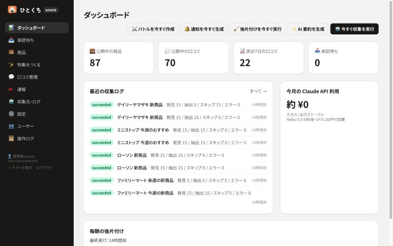 | 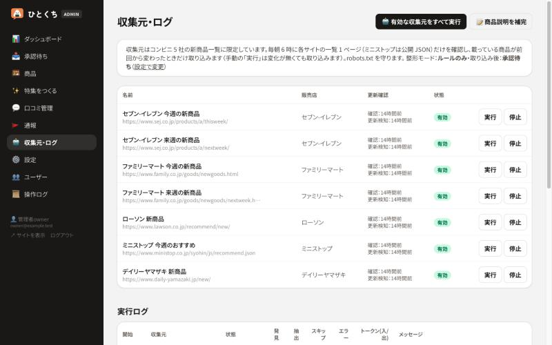 |
| 件数・収集ログ・API 利用額・毎朝の後片付けの結果を一覧。収集などを手動でも実行できる | コンビニ 5 社の収集元ごとに、更新の確認状況と実行ログを表示 |
| **特集エディタ** | **設定** |
| 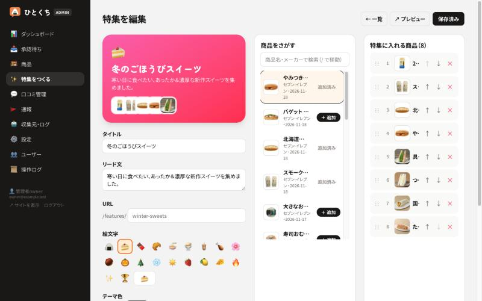 | 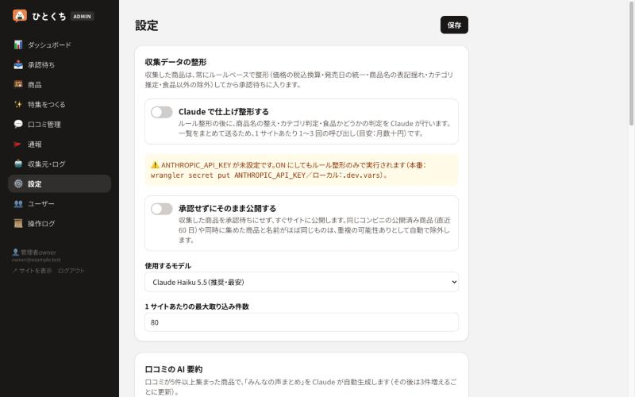 |
| 商品を検索して追加し、ドラッグやキーボードで並べ替えるだけで特集ページを作れる | 自動整形・自動公開・広告などを、コードを変えずに画面から切り替えられる |

> 画面の商品名・画像は、各社が公開している新商品情報をもとに表示しています。口コミの一部は表示確認用のデモデータです（「デモ」と表示）。

---

## 主な機能

### 1. 新商品の自動収集

毎朝 6 時に、コンビニ各社の新商品ページを確認します。

- **更新があったときだけ取り込む**：一覧に載っている商品の顔ぶれを前回と比べ、変わっていなければ何もしません。相手のサイトへの負荷と処理の無駄を抑えるためです。
- **自動で整形する**：価格は税込に、発売日は日付の形式にそろえ、商品名の表記ゆれを整え、カテゴリ（スイーツ・おにぎりなど 9 種類）を推定します。グッズやくじなど、食品でないものは除外します。設定で、仕上げに AI（Claude）を使うこともできます。
- **公開のしかたを選べる**：取り込んだ商品は「承認待ち」に入り、管理者が確認してから公開します。設定で「そのまま公開」に切り替えることもでき、その場合は名前がほぼ同じ商品を重複とみなして自動で除外します。
- **相手のサイトに配慮する**：robots.txt を守り、各サイトの一覧を 1 ページずつ、間隔を空けて取得します。

### 2. 口コミ

- 総合評価に加えて、**味・量・コスパ**の 3 つの観点で評価できます。写真も 1 枚添えられます。
- 星とひとことだけで投稿できる**「ひとこと口コミ」**を用意し、書く手間を減らしています。
- 写真は、送信する前にスマホやブラウザの側で縮小・圧縮します（長辺 1280px・約 200KB）。位置情報などの付帯情報も残りません。

### 3. 書きたくなる・また来たくなる仕掛け

| 機能 | 内容 |
|---|---|
| Good / Bad | 参考になった口コミに Good を付けられます。Bad が多い口コミは自動で非公開にし、管理者が確認します |
| レビュアーランク | 口コミの数や、もらった Good の数でポイントがたまり、ブロンズ → シルバー → ゴールド → プラチナとランクが上がります。ランクに応じて口コミの装飾が変わります |
| ファーストレビュー | 発売から 3 日以内に、最初の口コミを書いた人にボーナスポイントとバッジを付けます |
| 実績バッジ | 「コンビニ 5 社制覇」「4 週連続投稿」など 13 種類 |
| 新商品バトル | 毎週、ジャンルごとに注目の新商品どうしの対決を自動で組みます。どちらが気になるか投票でき、投票は 1 人 1 回です |
| 気になる・お知らせ | 気になる商品を登録しておくと、発売日にお知らせします。食べたあとには口コミのお願いも届きます |
| あなたへのおすすめ | 「気になる」や高評価の口コミから好みのカテゴリやチェーンを推定し、新商品をおすすめします |
| 口コミの AI 要約 | 口コミが 5 件たまると、「みんなの声まとめ」として良い点・気になる点を AI が要約します |

### 4. 会員機能

- **Google アカウントでログイン**します。パスワードを持たないので、漏れたり総当たりされたりする心配がありません。
- サイトに表示されるのは、本人が決めたニックネームだけです。年代・性別は、本人が「公開する」を選んだ場合だけ表示されます。
- マイページから、自分の口コミの削除や退会がいつでもできます。

### 5. 管理画面

| 画面 | できること |
|---|---|
| ダッシュボード | 公開中の商品数・口コミ数、収集ログ、AI の利用額の目安、毎朝の後片付けの結果を確認できます |
| 承認待ち | 収集した商品を確認し、必要なら手直しして公開します |
| 商品・口コミ | 商品情報の編集や非公開、問題のある口コミの対応ができます |
| 通報・ユーザー | 利用者からの通報に対応し、悪質な利用者のアカウントを停止できます |
| 特集をつくる | 商品を検索して追加し、並べ替えるだけで特集ページを作れます。マウスでもキーボードだけでも操作できます |
| 収集元・ログ | 収集元ごとに、有効／停止の切り替えや手動実行ができます |
| 設定 | 自動整形・自動公開・広告・アフィリエイト・運営者情報などを、コードを変えずに切り替えられます |
| 操作ログ | 管理者の操作を、誰が・いつ・何をしたか記録しています |

### 6. 自動のメンテナンス

毎朝、次の後片付けを自動で行い、結果をダッシュボードに表示します。

- 発売から 1 か月を過ぎた商品を、口コミなどと一緒に削除する（「いま買える新商品」に絞ったサイトのため）
- どこからも使われていない画像を削除する
- 期限切れのログイン情報や古い通知を削除する

### 7. 収益化

- 広告枠（Google AdSense・楽天の画像広告）と、通販リンク（楽天・Amazon）を表示できます。
- ステルスマーケティング規制に沿って、広告には「広告」、通販リンクには「PR」を明示しています。
- 楽天の広告コードは、楽天以外のサイトを読み込むものを保存できないようにしたうえで、読み込める先を楽天のドメインに制限しています。

### 8. スマホでの使いやすさ

- ホーム画面に追加すると、アプリのように全画面で開けます（PWA）。
- 初めて来た人には、サイトの説明と使い方を一度だけ表示します。検索などから商品ページに直接来た人には、読みたい内容を隠さないよう小さな案内だけを出します。

---

## 仕組み

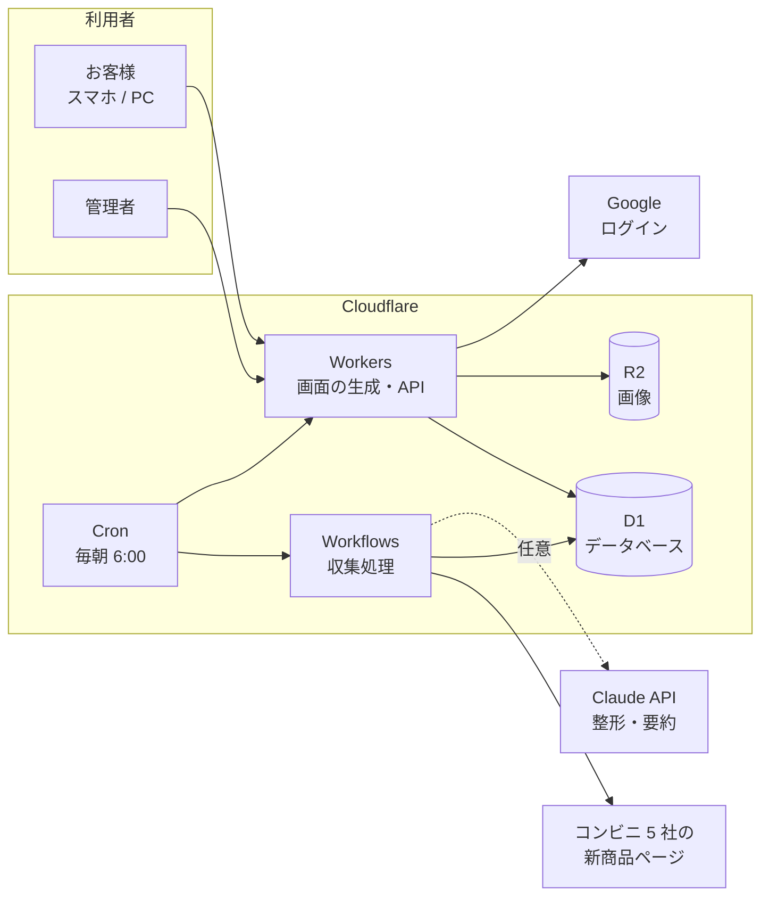

- 画面は **Cloudflare Workers** 上で React Router によってサーバー側で生成し、表示を速くしつつ、商品ページごとに検索エンジン向けのタイトルや説明文を付けています。
- データは **D1**（SQLite）、利用者がアップロードした画像は **R2** に保存します。商品画像は保存せず、各社が公開している画像をそのまま表示します。
- 新商品の収集は、**Cron**（定期実行）から **Workflows** を起動して行います。処理を段階に分けて途中結果を保存するので、途中で失敗してもその段階からやり直せます。

### 収集の流れ

1. 収集元（7 ページ）ごとに処理を分け、同じサイトに同時にアクセスしないよう、開始を 2 分ずつずらす
2. 一覧ページを取得し、載っている商品の顔ぶれが前回と同じなら終了する
3. すでに取り込んだ商品を除き、新しい商品だけをルールで整形する
4. 新しい商品の詳細ページから、商品説明とカロリーを取得する
5. （設定がオンなら）AI で商品名やカテゴリを仕上げる
6. 承認待ちに保存する。または、重複を除いてそのまま公開する

各社のページの作りが変わって商品が 1 件も取れなかった場合は、エラーとして記録され、管理画面で気づけます。

---

## 使用技術

| 分類 | 技術 |
|---|---|
| フロントエンド | TypeScript, React 19, React Router v7（SSR）, Tailwind CSS v4, PWA |
| サーバー | Cloudflare Workers, Cloudflare Workflows, Cron Triggers |
| データベース・ストレージ | Cloudflare D1（SQLite・FTS5 による日本語の部分一致検索）, Cloudflare R2 |
| 認証 | Google OAuth 2.0 / OpenID Connect（PKCE）を自前で実装 |
| 外部サービス | Claude API（整形・要約）, Resend（メール配信）, Google AdSense, 楽天アフィリエイト |
| テスト・CI/CD | Vitest（Workers の実行環境上で単体・結合テスト 151 件）, GitHub Actions, Cloudflare Workers Builds |

### 選んだ理由

- **Cloudflare（Workers / D1 / R2）**：サーバーの管理が要らず、無料枠が大きいからです。小さく始めて、うまくいかなくても費用がほとんどかからない構成を重視しました。画像の転送量が無料の R2 は、画像を多く扱う口コミサイトと相性が良いと考えました。
- **React Router v7（SSR）**：商品ページを検索エンジンに載せたかったので、サーバー側で画面を作れるフレームワークを選びました。
- **Workflows**：コンビニ各社のサイトを間隔を空けて巡回する、時間のかかる処理に向いています。失敗した段階からやり直せるので、相手のサイトに余計なアクセスをせずに済みます。
- **ルール ＋ AI の整形**：表記ゆれの多い商品名やカテゴリの判定は、ルールだけでは限界があります。ただし費用を抑えたいので、ルールでの整形を基本にし、AI は設定で使うかどうかを選べるようにしました。

---

## 品質とセキュリティ

### 自動テストとデプロイ

- `main` にプッシュすると、型チェックと **151 件の自動テスト**が GitHub Actions と Cloudflare の両方で実行されます。**1 つでも失敗すると本番には反映されません。**
- テストは本番と同じ Workers の実行環境で動き、データベースや画像の保存を伴う処理も、テスト専用の環境で確かめています。
- 対象は、収集データの整形、各社ページの読み取り、重複判定、承認と自動公開、自動削除、口コミの評価、ランクの計算、バトル、通知、アカウント停止、ログイン、管理画面の保護、画像の検査などです。

### 主なセキュリティ対策

| 対象 | 対策 |
|---|---|
| 管理画面 | 管理者ロールの確認、ログインから 12 時間を過ぎたら再ログイン、他サイトからの操作の拒否、全操作の記録。設定で、管理画面を専用ドメインや Cloudflare Access の認証の内側に置くこともできます |
| ログイン | セッションのトークンはデータベースにハッシュ化して保存し、Cookie は JavaScript から読めない設定（HttpOnly）にしています |
| 画像のアップロード | 申告された形式ではなく、ファイルの中身で画像かどうかを確認します。画像以外（SVG など）は受け付けません |
| 全ページ | 他サイトからの書き込みリクエストを拒否し、各種セキュリティヘッダーを付けています |
| 秘密情報 | API キーなどはリポジトリに置かず、Cloudflare のシークレットに保存しています |

---

## ディレクトリ構成

```
app/
  routes/site/      お客様向けの画面
  routes/admin/     管理画面
  routes/auth/      Google ログイン
  components/       画面の部品
  lib/              業務ロジック（口コミ・ランク・バトル・自動削除など）
workers/
  app.ts            入口（画面の配信・定期実行）
  scrape-workflow.ts  収集処理
  scrape/           各社ページの読み取り・整形・取得
db/migrations/      データベースの定義
test/               自動テスト
docs/               設計書
```

---

## ローカルで動かす

```bash
npm install
cp .dev.vars.example .dev.vars
npm run db:migrate:local
npm run dev
```

- サイト：http://localhost:5173
- 管理画面：http://localhost:5173/admin （ローカルでは、ログイン画面の「開発用 管理者ログイン」で入れます）
- 表示確認用のデモデータ：`npm run demo:add:local`（削除は `npm run demo:remove:local`）
- テスト：`npm test`
- 型チェック・テスト・ビルドをまとめて実行：`npm run check`

---

## ドキュメント

要件定義から設定の一覧まで、設計書を [docs/](docs/README.md) にまとめています。

| 文書 | 内容 |
|---|---|
| [要件定義](docs/01-requirements.md) | 目的、利用者、機能・非機能要件、収益化の前提 |
| [機能設計](docs/02-functional-design.md) | 機能ごとのルール（収集、口コミ、ランク、バトル、自動削除など） |
| [外部設計](docs/03-external-design.md) | 画面と URL、外部サービスとの連携、定期実行 |
| [内部設計](docs/04-internal-design.md) | 構成、データベース設計、主要な処理の流れ、セキュリティ |
| [設定一覧](docs/05-configuration.md) | 環境変数、シークレット、管理画面の設定、コード内の定数 |
| [テストと運用](docs/06-testing-operations.md) | テストの内容、デプロイの流れ、運用の手順 |

---

## 今後の展望

- 独自ドメインへの移行と、検索からの流入を増やすための改善
- 口コミの件数・閲覧数の分析
- ブラウザ操作を伴う画面のテスト（E2E）の追加
