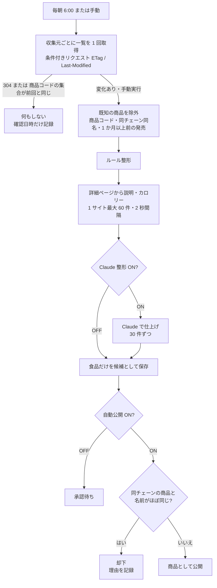

# 2. 機能設計

## 2.1 機能一覧

| 分類 | 機能 | 主な実装 |
|---|---|---|
| 収集 | 新商品の自動収集（更新検知つき） | `workers/scrape-workflow.ts`, `workers/scrape/*` |
| 収集 | ルール整形／Claude 整形 | `workers/scrape/normalize.ts`, `claude-normalize.ts` |
| 収集 | 承認／自動公開（重複除外） | `app/lib/candidates.server.ts`, `app/routes/admin/candidates.tsx` |
| 閲覧 | ホーム、商品一覧・検索、商品詳細 | `app/routes/site/home.tsx`, `products.tsx`, `product.tsx` |
| 閲覧 | 週間まとめ、新商品バトル | `weekly.tsx`, `app/lib/battles.server.ts` |
| 閲覧 | 特集（管理者作成）、地域限定リスト | `features/*`, `app/lib/custom-features.server.ts`, `features.server.ts` |
| 会員 | Google ログイン、プロフィール、退会 | `app/lib/auth.server.ts`, `mypage.tsx` |
| 会員 | 口コミ、ひとこと口コミ、写真 | `product.tsx`, `post.tsx`, `app/components/photo-input.tsx` |
| 会員 | Good / Bad、レビュアーランク、実績 | `app/lib/db.server.ts`, `reviewer-tier.ts`, `achievements.server.ts` |
| 会員 | 気になる、食べた、通知、おすすめ | `api/bookmark.ts`, `api/eaten.ts`, `engage.server.ts`, `recommend.server.ts` |
| 会員 | 通報 | `product.tsx`（intent=report）, `app/lib/reports.ts` |
| 運営 | 管理画面一式 | `app/routes/admin/*` |
| 運営 | アカウント停止 | `app/lib/suspension.server.ts` |
| 運営 | 毎朝の後片付け（古い商品・未使用画像・期限切れデータ） | `app/lib/retention.server.ts` |
| 収益 | 広告枠、アフィリエイトリンク、ads.txt | `app/components/ad-slot.tsx`, `affiliate-links.tsx`, `app/routes/seo/ads.ts` |
| 任意 | AI 要約、ダイジェストメール、PWA | `summary.server.ts`, `digest.server.ts`, `public/sw.js` |

## 2.2 新商品の収集

| ルール | 内容 |
|---|---|
| 収集元 | 5 社・7 ページ（[設定一覧 5.5](05-configuration.md#55-収集元)）。管理画面で有効／停止を切り替える |
| 更新検知 | 一覧に載っている商品コードを並べ替えてハッシュ化し、前回と比べる。並び順・広告・日付表示の変化には反応しない |
| 手動実行 | 変化が無くても取り込む |
| 価格 | 税込に統一。本体価格しか無ければ 8% で換算。小数は切り捨て |
| 発売日 | `YYYY-MM-DD` に統一。年が無ければ基準日に近い年を補う。載っていないサイトは初回取得日 |
| カテゴリ | サイト上の表記 → 商品名のキーワードの順に 9 カテゴリへ割り当てる |
| 食品以外 | グッズ・くじ・日用品などは除外する（食玩のグミなどは残す） |
| 重複（収集時） | 同じ商品コード、同チェーンの同名（60 日以内）、過去に削除した商品コード（`scrape_seen`） |
| 重複（自動公開時） | 同チェーンの直近 60 日の商品・同時に集めた商品と、名前の似ている度合い（2 文字ずつの重なり）が 0.85 以上 |
| 礼儀 | robots.txt を確認。User-Agent は `HitokuchiBot/1.0`。タイムアウト 20 秒。失敗時は 2 回まで再試行 |

## 2.3 口コミ

| 項目 | ルール |
|---|---|
| 投稿できる人 | ログイン済みで、ニックネームを設定済みの会員 |
| 通常の口コミ | 総合評価（1〜5）必須、味・量・コスパ（任意）、タイトル 40 字まで、本文 10〜1000 字、写真 1 枚（任意） |
| ひとこと口コミ | 星と 60 字までの本文。写真なし |
| 写真 | 端末側で長辺 1280px・約 200KB 以下に圧縮。サーバーは 600KB 以下で中身が JPEG / PNG / WebP / GIF のものだけ受け付ける |
| 回数制限 | 同じ商品へは 1 日 1 件、全体で 1 日 30 件 |
| 自動チェック | NG ワード・URL を含むと「要確認」（非公開）になり、管理者が判断する |
| ファーストレビュー | 発売（または掲載）から 3 日以内で、その商品の最初の公開口コミ。ボーナス +5pt と通知 |
| 投稿後 | 「食べた」を自動で記録。商品の平均評価・レビュアーの集計・実績を更新。口コミが 5 件たまると AI 要約を作成（設定 ON かつ API キーがある場合） |

### Good / Bad

- 自分の口コミ・非公開の口コミには付けられない。
- 同じボタンをもう一度押すと取り消し、逆を押すと切り替え。
- Bad が 5 件以上で Good の 2 倍を超えると、自動で「要確認」になる。
- プロフィールには Bad の数を表示しない（ポイントの計算には使う）。

### レビュアーのランク

ポイント = 口コミ数 × 3 + もらった Good × 2 + ファーストレビュー × 5 − もらった Bad（0 未満にはならない）

| ランク | 必要ポイント |
|---|---|
| レビュアー | 0 |
| ブロンズ 🥉 | 10 |
| シルバー 🥈 | 30 |
| ゴールド 👑 | 80 |
| プラチナ 💎 | 200 |

### 実績（13 種）

はじめのひとくち、常連さん、レビューの達人、コンビニ 5 社制覇、スイーツハンター、おにぎり番長、パン好き、麺すすり隊、一番乗り、フロンティア、みんなの参考書、4 週連続投稿、気になるコレクター。達成時に通知する。

## 2.4 通報とアカウント停止

- 通報はログイン必須。理由は「スパム・宣伝」「誹謗中傷・嫌がらせ」「なりすまし」「不適切な内容・画像」「その他」。
- 同じ口コミが 3 人以上から通報されると、自動で「要確認」になる。
- 管理者は通報を「対応済み」「問題なし」にできる。
- アカウント停止：ログイン不可、セッション削除、公開中の口コミを非表示、未対応の通報を対応済みに。解除すると、停止で非表示にした口コミだけが元に戻る。
- 管理者・オーナー・自分自身は停止できない。

## 2.5 新商品バトル

- 毎朝の定期実行で、その週（月〜日）に発売の商品から、ジャンルごとに 1 つ作る。すでにあるジャンルは作らない。
- 対戦カードは「気になる × 2 + 口コミ × 3 + 食べた」の多い順で 1 位と、できるだけ別チェーンの 2 位。
- 画像の無い商品・非公開の商品は出さない。1 ジャンルに 2 商品以上が必要。
- 投票は確認ダイアログのあとで確定し、1 人 1 回、変更不可。未ログインは匿名 Cookie（`hk_bv`）で識別する。

## 2.6 特集

- 管理者が作る特集：タイトル、リード文、絵文字、テーマ色、商品（ドラッグまたはキーボードで並べ替え）、下書き／公開。下書きは管理者だけが `?preview` で見られる。
- 地域限定リスト：販売地域が 1〜3 エリアに限られる直近 90 日の商品を、9 エリア別に表示する。
- 季節・テーマの自動特集は廃止した。

## 2.7 通知・おすすめ・メール

| 機能 | ルール |
|---|---|
| 発売日の通知 | 気になる商品の発売日当日に通知 |
| 口コミのお願い | 気になる／食べた商品で、発売から 3〜21 日たっても自分の口コミが無いとき |
| あなたへのおすすめ | 気になると ★4 以上の口コミから好みのカテゴリ・チェーンを推定し、未登録・未口コミの最近の商品を選ぶ |
| ダイジェストメール | 月曜 8:00。配信を希望した会員だけに、今週発売の気になる商品とおすすめを送る（設定 ON、Resend の設定が必要） |

## 2.8 毎朝の後片付け

| 処理 | 内容 |
|---|---|
| 古い商品の削除 | 発売日（無ければ掲載日）から 30 日を過ぎた商品を削除。口コミ・気になる・食べた・通知・バトル・特集の登録・Good/Bad・通報も一緒に消える。R2 の商品画像・口コミ写真を削除し、レビュアーの集計を計算し直す |
| 再収集の防止 | 削除した商品の商品コードを `scrape_seen` に残す（180 日） |
| 未使用画像の削除 | R2 にあるのに、ユーザー・口コミ・商品のどれからも参照されていない画像を削除。アップロードから 24 時間以内のものは触らない。1 回で最大 5,000 個を確認し、続きは翌日 |
| 期限切れデータ | 期限切れのセッション、90 日より前の通知、1 年より前の監査ログ、30 日より前の候補、90 日より前の収集ログ |
| 記録 | 結果を管理画面のダッシュボードに表示。手動でも実行できる |

## 2.9 収益化

- 広告枠（`AdSlot`）：設定で広告を有効にし、AdSense のクライアント ID とスロット ID を入れると表示する。「広告」と明示する。
- アフィリエイト：商品詳細で、スナック・チョコ・ドリンク・麺のカテゴリだけに「Amazon で探す」「楽天市場で探す」を出す。「PR」と明示し、`rel="sponsored"` を付ける。
- `/ads.txt` は AdSense のクライアント ID から自動で作る。

## 2.10 ようこそガイド

初めて来た人に、サイトが何かと使い方を案内する。実装は `app/components/welcome.tsx`、出し方の判定は `app/lib/welcome.ts`。

| 状況 | 表示 |
|---|---|
| トップ（`/`）に初めて来た | 3 ページのガイド（スマホは下から出るシート、PC は中央）。①ひとくちとは ②できること ③ログインについて。「スキップ」・背景のタップ・Esc で閉じる。矢印キーでページ送り |
| 商品ページなどに直接来た（検索・SNS から） | 画面下に小さな「はじめての方へ」の案内。タップするとガイドを開く。読みたい内容は隠さない |
| 一度閉じた・ログイン中・検索エンジンなどのボット | 出さない |
| 説明ページ・ログイン・マイページ・投稿など | 出さない |

- 表示はブラウザ側だけで判定し、サーバーが返す HTML には含めない（検索エンジンの評価に影響しない）。
- 閉じたことはブラウザの `localStorage`（`hk_welcome_v1`）に記録する。内容を大きく変えたときはキーの番号を上げると、全員にもう一度表示される。
- ガイドを閉じるまでは「ホーム画面に追加」の案内を出さない（重ならないように）。
- `/about` の「かんたんな使い方を見る」から、いつでも開き直せる。

