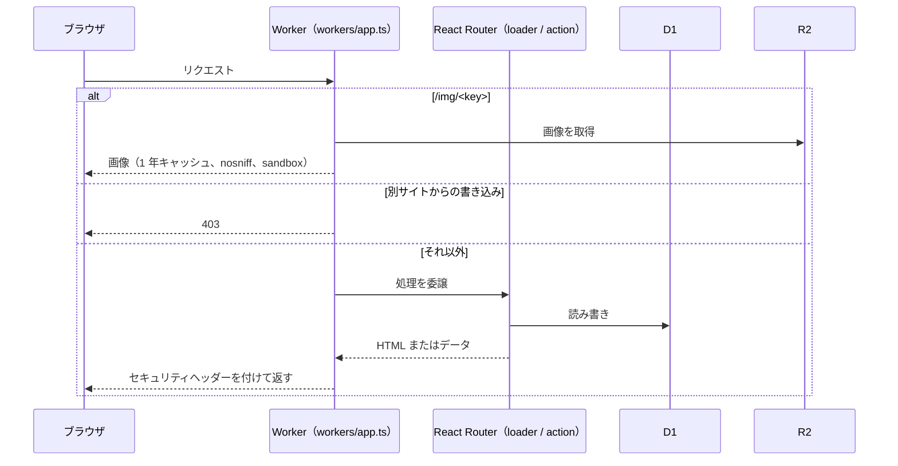
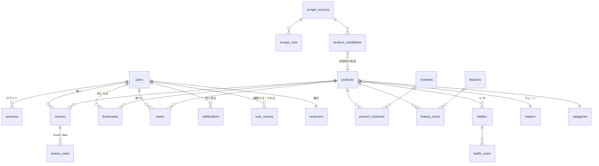
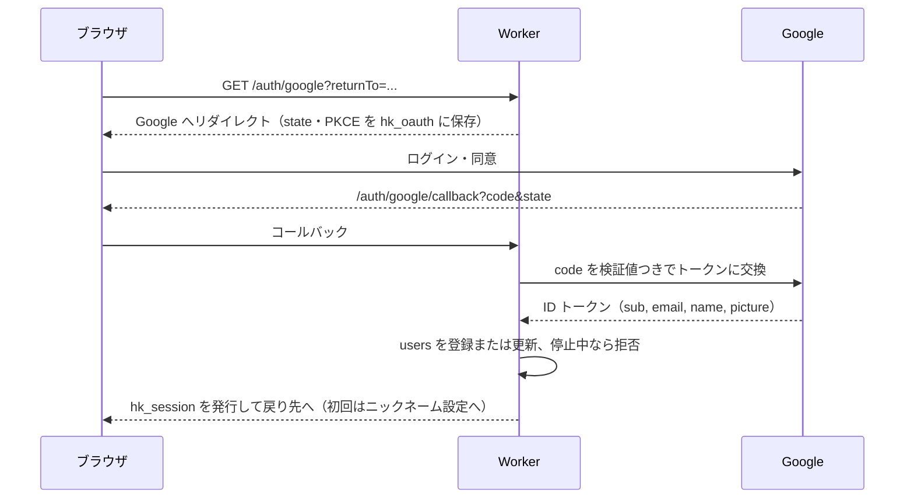

# 4. 内部設計

## 4.1 技術スタック

| 層 | 採用技術 | 役割 |
|---|---|---|
| 実行環境 | Cloudflare Workers（`nodejs_compat`） | サーバー側の描画、API、定期実行 |
| フレームワーク | React Router v7（framework mode、SSR）＋ React 19 | ルーティング、loader / action、画面 |
| ビルド | Vite 8、`@cloudflare/vite-plugin` | 開発サーバーと本番ビルド |
| スタイル | Tailwind CSS v4 | デザイン |
| 言語 | TypeScript 6（strict） | 型チェック |
| DB | Cloudflare D1（SQLite、FTS5 trigram） | すべての業務データ |
| ファイル | Cloudflare R2 | プロフィール画像、口コミ写真 |
| ジョブ | Cloudflare Workflows、Cron Triggers | 収集パイプライン、定期実行 |
| AI | Claude API（`@anthropic-ai/sdk`、Haiku 5.5、構造化出力） | 収集データの仕上げ、口コミ要約（任意） |
| メール | Resend（HTTP API） | ダイジェスト（任意） |
| テスト | Vitest 4、`@cloudflare/vitest-plugin` | Workers ランタイム上での単体・結合テスト |
| CI/CD | GitHub Actions、Cloudflare Workers Builds | テストとデプロイ |

## 4.2 ディレクトリ構成

```
hitokuchi/
├─ app/
│  ├─ root.tsx                 全ページ共通（設定・ログイン状態の読み込み、エラー画面）
│  ├─ routes.ts                URL と画面の対応表
│  ├─ routes/
│  │  ├─ site/                 お客様向けの画面
│  │  ├─ admin/                管理画面
│  │  ├─ auth/                 Google ログイン、ログアウト、開発用ログイン
│  │  ├─ api/                  気になる・食べた・バトル投票
│  │  └─ seo/                  sitemap.xml、robots.txt、ads.txt
│  ├─ components/              画面部品（カード、星、ロゴ、タブバー、画像入力など）
│  └─ lib/                     業務ロジック
│     ├─ *.server.ts           サーバー専用（DB・R2・外部 API を使う）
│     └─ *.ts                  ブラウザでも使う純粋な関数（整形、ランク計算、画像圧縮など）
├─ workers/
│  ├─ app.ts                   Worker の入口（fetch と scheduled）
│  ├─ security.ts              セキュリティヘッダー、CSRF 判定
│  ├─ scrape-workflow.ts       収集パイプライン（Workflows）
│  └─ scrape/                  アダプター、整形、取得、Claude 整形
├─ db/migrations/              D1 のマイグレーション（0001〜0013）
├─ db/demo/                    ローカル用のデモデータ（本番には入れない）
├─ public/                     アイコン、manifest、Service Worker、オフライン画面
├─ test/                       自動テスト（unit / integration）
├─ scripts/                    アイコン生成、デプロイ前のテスト実行
├─ docs/                       この設計書
├─ .github/workflows/ci.yml    CI
├─ wrangler.jsonc              Cloudflare の設定
└─ vitest.config.ts            テストの設定
```

## 4.3 リクエストの流れ



- `root.tsx` の loader が、公開用の設定・ログイン中のユーザー・気になる／食べたの ID・未読数を読み込み、全ページで使う。
- 画面の loader がデータを読み、action がフォーム送信を処理する。管理画面の loader / action は必ず `requireAdmin` を最初に呼ぶ。

## 4.4 データベース設計



| テーブル | 役割 | 主な列 |
|---|---|---|
| `products` | 公開する商品 | `name`, `maker_id`, `category_id`, `price`（税込）, `kcal`, `description`, `image_url`（各社の URL）, `image_key`（R2）, `region`, `released_on`, `status`（published / hidden）, `rating_avg`, `review_count`, `ai_summary` |
| `products_fts` | 商品名・チェーン名の全文検索（FTS5 trigram、`rowid` = 商品 ID） | `name`, `maker` |
| `makers` | チェーン名 | `name` |
| `categories` | 9 カテゴリ | `slug`, `name`, `emoji`, `sort` |
| `channels` / `product_channels` | 販売店（5 社）と商品の対応 | — |
| `reviews` | 口コミ | `product_id`, `reviewer_id`, `nickname`, `rating`, `taste`, `volume`, `value`, `title`, `body`, `image_key`, `status`（published / hidden / flagged）, `good_count`, `bad_count`, `is_first`, `is_quick`, `hidden_by_suspension` |
| `review_votes` | Good / Bad（1 人 1 票） | `review_id`, `voter_id`, `value` |
| `reviewers` | レビュアーごとの集計（ランク表示用） | `review_count`, `good_received`, `bad_received`, `first_count` |
| `users` | 会員 | `google_sub`, `email`, `nickname`, `avatar_key`, `age_group`, `gender`, `show_age`, `show_gender`, `digest_opt_in`, `role`（user / admin）, `suspended_at` |
| `sessions` | ログインセッション | `id`（トークンの SHA-256）, `user_id`, `expires_at` |
| `bookmarks` / `eaten` | 気になる／食べた | `user_id`, `product_id` |
| `notifications` | 通知（重複防止の一意制約つき） | `kind`, `product_id`, `ref`, `body`, `link`, `read_at` |
| `battles` / `battle_votes` | 週・ジャンルごとのバトルと投票 | `week`, `category_id`, `product_a`, `product_b` / `voter_key`, `choice` |
| `features` / `feature_items` | 管理者が作る特集と、その商品の並び | `slug`, `title`, `theme`, `status` / `position` |
| `user_reports` | 通報 | `reporter_id`, `target_user_id`, `review_id`, `reason`, `status` |
| `scrape_sources` | 収集元 | `adapter`, `url`, `enabled`, `max_items`, `list_hash`, `etag`, `last_modified`, `checked_at`, `changed_at` |
| `scrape_runs` | 収集の実行ログ | `status`, `found`, `extracted`, `skipped`, `errors`, `input_tokens`, `output_tokens`, `message` |
| `product_candidates` | 収集結果（承認待ち・承認済み・却下） | `external_key`（`アダプター:商品コード`）, `duplicate_of`, `status`, `note`, `normalized_by` |
| `scrape_seen` | 削除済みの商品コード（再収集の防止） | `external_key`, `seen_at` |
| `settings` | 管理画面の設定と、後片付けの記録 | `key`, `value` |
| `admin_audit_logs` | 管理操作の履歴 | `email`, `action`, `target`, `detail`, `ip` |

補足：
- 商品を削除すると、口コミ・投票・気になる・食べた・通知・バトル・特集の登録は外部キーの `ON DELETE CASCADE` で一緒に消える。`product_candidates` と `products_fts` は連動しないので、コード側で先に消す（`retention.server.ts`）。
- `reports` と `scraped_pages` は初期の設計の名残で、現在は使っていない。
- D1 の制約：1 つの SQL にバインドできる値は 100 個まで。まとめて処理するときは 80 個ずつに分け、`DB.batch` で 1 回の通信にまとめる。

## 4.5 主要な処理

### ログイン



- セッショントークンはランダムな値で、DB には SHA-256 のハッシュだけを保存する。DB が漏れてもログインを乗っ取れない。
- 戻り先は自サイト内の相対パスだけを許可する（`safeReturnTo`）。

### 画像のアップロード

1. ブラウザで縮小・再圧縮する（`app/lib/image.ts` の `compressImage`）。プロフィール画像は 240px の正方形で約 20KB、口コミ写真は長辺 1280px で約 200KB。WebP を書き出せないブラウザは JPEG。
2. サーバーは、サイズ上限（100KB / 600KB）と、中身の先頭バイトで形式を確認する（`sniffImage`）。SVG などは拒否する。
3. R2 にランダムなキーで保存し、DB にキーを記録する。古い画像は削除する。
4. 配信は `/img/<key>`。1 年キャッシュ、`nosniff`、`Content-Security-Policy: sandbox`。画像以外の Content-Type はダウンロード扱いにする。

### 収集（Workflows）

`ScrapeWorkflow.run` は、収集元ごとに `step.do` で区切って進む。各ステップは結果が保存されるので、途中で失敗してもそのステップから再試行される。流れは [機能設計 2.2](02-functional-design.md#22-新商品の収集) のとおり。

### 毎朝の後片付け

`runMaintenance`（`retention.server.ts`）が、古い商品の削除 → 未使用画像の削除 → 期限切れデータの削除を順に実行する。1 つが失敗しても残りは実行し、結果とエラーを `settings.maintenance_last` に保存する。

## 4.6 セキュリティ

| 対象 | 対策 |
|---|---|
| 管理画面 | ①管理者ロール（`ADMIN_EMAILS` のメールだけが自動で管理者になる）②ログインから 12 時間以内のセッションに限る ③`ADMIN_HOST` で専用ドメインに限定（任意）④Cloudflare Access の認証メールとの一致（任意）⑤別サイトからの変更リクエストを拒否 ⑥全操作を監査ログに記録 ⑦`noindex`・`no-store`・埋め込み禁止 |
| CSRF | すべての書き込みリクエストで `Origin`（無ければ `Sec-Fetch-Site`）を確認。Cookie は `SameSite=Lax` |
| セッション | `HttpOnly`・`Secure`。トークンはハッシュで保存。期限 30 日。停止中のユーザーは無効 |
| 画像 | 中身で形式を確認、サイズ上限、ランダムなキー、`nosniff` と `sandbox` で配信 |
| 入力 | SQL はすべてプレースホルダー。ニックネームは記号・URL・運営を装う名前を禁止。口コミは文字数と回数を制限 |
| ヘッダー | `X-Content-Type-Options`, `X-Frame-Options`, `Referrer-Policy`, `Strict-Transport-Security`, `Permissions-Policy` |
| 秘密情報 | API キーとクライアントシークレットは Cloudflare のシークレットに保存し、リポジトリには置かない。お客様向けの画面には公開用の設定だけを渡す |
| 開発用ログイン | `localhost` かつ `ADMIN_DEV_BYPASS=true` のときだけ有効。本番の設定は空 |
| 収集 | robots.txt の確認、取得先は DB に登録した公式ドメインのみ、応答は 3MB まで |
