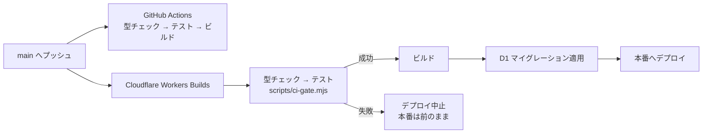

# 6. テストと運用

## 6.1 自動テスト

Vitest を、本番と同じ Workers ランタイム（workerd）の中で動かします。D1 と R2 はテスト専用のローカルのものが用意され、本番のデータには触れません。DB には本番と同じマイグレーションを適用します。

```bash
npm test
```

| ファイル | 種類 | 確認していること |
|---|---|---|
| `test/unit/normalize.test.ts` | 単体 | 価格・発売日・商品名・カロリーの整形、カテゴリ推定、食品以外の除外、重複判定（名前の似ている度合い） |
| `test/unit/adapters.test.ts` | 単体 | 5 社のアダプターが一覧・詳細から正しく取り出せること、ページ構造が変わったら 0 件になること |
| `test/unit/fetch.test.ts` | 単体 | 更新検知のハッシュ、条件付きリクエスト（304）、エラー応答、robots.txt の解釈 |
| `test/unit/security.test.ts` | 単体 | CSRF 判定、セキュリティヘッダー、画像の配信ヘッダー、画像形式の判定（SVG・HTML の拒否） |
| `test/unit/welcome.test.ts` | 単体 | ようこそガイドを出す・出さないの判定 |
| `test/unit/rules.test.ts` | 単体 | ランクとポイント、週の計算、表示の整形、地域限定の判定、ニックネーム、戻り先 URL、NG ワード、アフィリエイトリンク、AI 要約の条件 |
| `test/integration/schema.test.ts` | 結合 | 全マイグレーションの適用、収集元が公式ドメインだけであること、設定の初期値と保存 |
| `test/integration/candidates.test.ts` | 結合 | 候補の承認（商品・販売店・検索データの作成、手直しの反映、重複のマージ）、自動公開と重複除外 |
| `test/integration/retention.test.ts` | 結合 | 古い商品の削除（口コミ・画像・候補ごと）、再収集の防止、ポイントの再計算、未使用画像の削除、期限切れデータの削除 |
| `test/integration/reviews.test.ts` | 結合 | Good / Bad、自動の要確認、評価の集計、気になる、通知、アカウント停止と解除 |
| `test/integration/battles.test.ts` | 結合 | ジャンルごとの作成、重複して作らないこと、対象外の商品、投票は 1 人 1 回 |
| `test/integration/admin.test.ts` | 結合 | セッション（ハッシュ保存・期限・ログアウト）、管理画面の保護の各層、監査ログ |
| `test/integration/images.test.ts` | 結合 | プロフィール画像の保存・差し替え・削除、形式とサイズの検査 |

テストを足すとき：
- 純粋な関数は `test/unit/`、DB や R2 を使うものは `test/integration/` に置く。
- テスト用のデータは `test/helpers.ts` の `addUser` / `addProduct` / `addReview` / `addCandidate` で作る。
- 同じファイルの中ではデータが残るので、件数ではなく特定の ID やキーで確認する。

テストで守れていない範囲：画面の見た目と操作（ブラウザでの E2E）、実際の各社サイトに対する収集、Google ログインの本物のやり取り、Claude・Resend の呼び出し。

## 6.2 CI / CD



- GitHub Actions（`.github/workflows/ci.yml`）：`main` へのプッシュとプルリクエストで実行。結果はコミットの横のチェックマークで分かる。
- Cloudflare Workers Builds：`npm run build` の前に `prebuild` が走り、Workers Builds の中（環境変数 `WORKERS_CI` がある）でだけ型チェックとテストを実行する。失敗するとビルドが止まり、デプロイされない。
- `main` 以外のブランチは、プレビュー版がアップロードされるだけで本番は変わらない。

| コマンド | 内容 |
|---|---|
| `npm run dev` | 開発サーバー（http://localhost:5173） |
| `npm test` / `npm run test:watch` | テスト |
| `npm run typecheck` | 型チェック |
| `npm run check` | 型チェック → テスト → ビルドをまとめて実行 |
| `npm run lock:check` | `package-lock.json` が Cloudflare のビルド環境（npm 10）でも使えるか確認 |
| `npm run lock:refresh` | パッケージを足したあとに `package-lock.json` を作り直す |
| `npm run db:migrate:local` | ローカルの DB にマイグレーションを適用 |
| `npm run deploy` | 手元から直接デプロイ（通常は使わない。プッシュで自動デプロイされる） |

## 6.3 変更の手順

1. `~/Documents/hitokuchi` で変更する。DB を変えるときは `db/migrations/` に次の番号のファイルを足す（既存のファイルは書き換えない）。
2. `npm run check` で確認する。
3. コミットして `main` にプッシュする。1〜3 分で本番に反映される。
4. 失敗したら、GitHub のチェック、または Cloudflare ダッシュボードの Workers & Pages → hitokuchi → Deployments でログを見る。

## 6.4 日々の運用

| 頻度 | すること | 場所 |
|---|---|---|
| 毎日（自動公開オフのとき） | 承認待ちの確認・承認 | `/admin/candidates` |
| 毎日 | 要確認の口コミ・通報の確認 | `/admin/reviews`, `/admin/reports` |
| 週 1 回 | 収集ログに失敗が無いか、後片付けが動いているか | `/admin`（ダッシュボード）, `/admin/sources` |
| 随時 | 特集の作成 | `/admin/features` |
| 月 1 回 | Cloudflare の利用量（D1、R2、Workers）と Claude API の利用額 | Cloudflare ダッシュボード、`/admin` |

## 6.5 困ったとき

| 症状 | 原因の見当 | 対応 |
|---|---|---|
| ある収集元が「商品が 0 件でした」で失敗する | その会社のページ構造が変わった | `workers/scrape/adapters.ts` の該当アダプターを直し、`test/unit/adapters.test.ts` の HTML も実物に合わせて更新する。直るまでは収集元を停止する |
| 収集が何日も動かない | 一覧に変化が無い（正常）か、robots.txt で禁止された | `/admin/sources` の「確認」「更新検知」の日時と、ログのメッセージを見る。手動の「実行」は変化が無くても取り込む |
| ログインすると「設定が完了していません」 | `GOOGLE_CLIENT_ID` か `GOOGLE_CLIENT_SECRET` が無い | [5.2](05-configuration.md#52-環境変数vars)・[5.3](05-configuration.md#53-シークレット) を確認 |
| 自分以外がログインできない | Google の同意画面が「テスト」のまま | Google Cloud Console で「本番環境」に切り替える |
| 管理画面に入れない | メールが `ADMIN_EMAILS` と違う、またはログインから 12 時間を過ぎた | メールを確認し、ログインし直す |
| プッシュしたのに反映されない | テストかビルドが失敗している | GitHub のチェックか Workers Builds のログを見る |
| ビルドが `npm ci` の「Missing: … from lock file」で失敗する | 手元（npm 11）でパッケージを足すと、npm 10 が必要とする記録が `package-lock.json` から抜けることがある | `npm run lock:refresh` で作り直してプッシュする。CI の「package-lock.json の確認」でも検知される |
| デプロイ後に画面がおかしい | 不具合のあるコードが出た | Cloudflare ダッシュボードの Deployments で前のバージョンにロールバックし、あとで直してプッシュする |
| Service Worker が原因で古い画面が出続ける | キャッシュの不整合 | `public/sw.js` の `KILL_SWITCH` を `true` にしてデプロイする |
| 間違って商品や口コミを消した | — | D1 の Time Travel で過去の時点に戻せる（無料プランは 7 日以内、有料プランは 30 日以内）（`npx wrangler d1 time-travel restore hitokuchi-db --timestamp=<日時>`）。DB 全体が戻るので、実行前に影響を確認する |

## 6.6 公開前のチェックリスト

- [ ] 管理画面の「設定」で運営者名とお問い合わせ先を入力した
- [ ] 利用規約とプライバシーポリシーの内容を確認した（ひな形です。必要なら専門家に確認してください）
- [ ] Google の OAuth 同意画面を「本番環境」にした
- [ ] 独自ドメインを設定し、`SITE_ORIGIN` と Google のリダイレクト URI を変更した
- [ ] 各コンビニの利用規約（画像・商品情報の利用）を確認した
- [ ] 管理画面に Cloudflare Access を付けた（推奨）
- [ ] 本番の DB にデモデータが入っていないことを確認した
- [ ] スマホの実機で、ホーム画面への追加とオフライン表示を確認した
