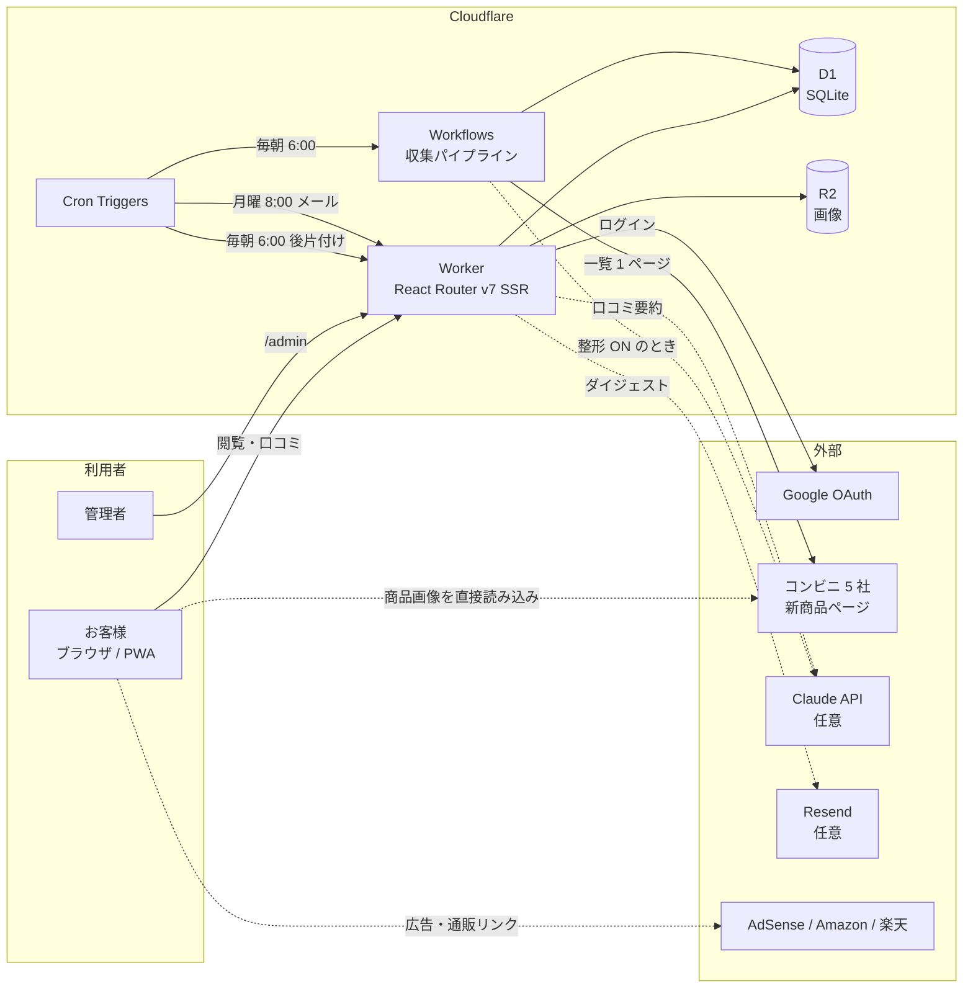

# ひとくち 設計ドキュメント

コンビニ新商品の口コミサイト「ひとくち」の設計書です。コードと同じリポジトリで管理し、機能を変えたら同じコミットで更新します。

| # | 文書 | 内容 |
|---|---|---|
| 1 | [要件定義](01-requirements.md) | 目的、利用者、機能要件・非機能要件、制約、収益化の前提 |
| 2 | [機能設計](02-functional-design.md) | 機能一覧と、機能ごとのルール（口コミ、ランク、バトル、収集、自動削除など） |
| 3 | [外部設計](03-external-design.md) | 画面と URL、フォーム・API、外部サービスとの連携、定期実行、メール |
| 4 | [内部設計](04-internal-design.md) | アーキテクチャ、ディレクトリ構成、DB 設計、主要な処理の流れ、セキュリティ |
| 5 | [設定一覧](05-configuration.md) | wrangler 設定、環境変数、シークレット、管理画面の設定、コード内の定数、外部サービス側の設定 |
| 6 | [テストと運用](06-testing-operations.md) | 自動テストの構成、CI/CD、デプロイ、日々の運用、障害時の対応 |

## 全体像

- 公開 URL：https://hitokuchi.ak-lumina-inc.workers.dev
- リポジトリ：https://github.com/Beachovin/hitokuchi（公開）。`main` にプッシュすると、テストが通った場合だけ本番に反映されます。
